# XELEO TV for onn TV

[Español](README.md) · **English**

A home screen for the **onn 4K Streaming Box** (Google TV), with no ads and no recommendations: everything on it
is something you installed. Built and tested on an onn 4K running Google TV 14; it should work on other Google TV
or Android TV devices, but it hasn't been tested on them.

The app itself is in Spanish; screen names below are given as they appear on the TV, with their meaning.

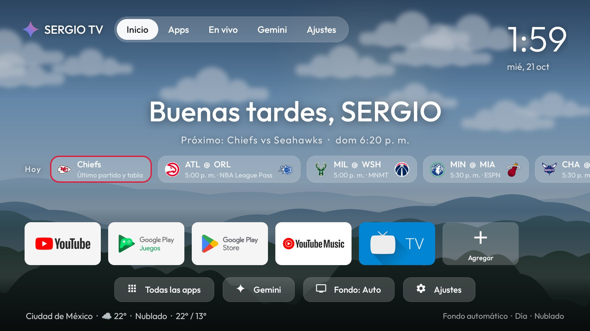

| At night | Your team's game day |
|---|---|
| 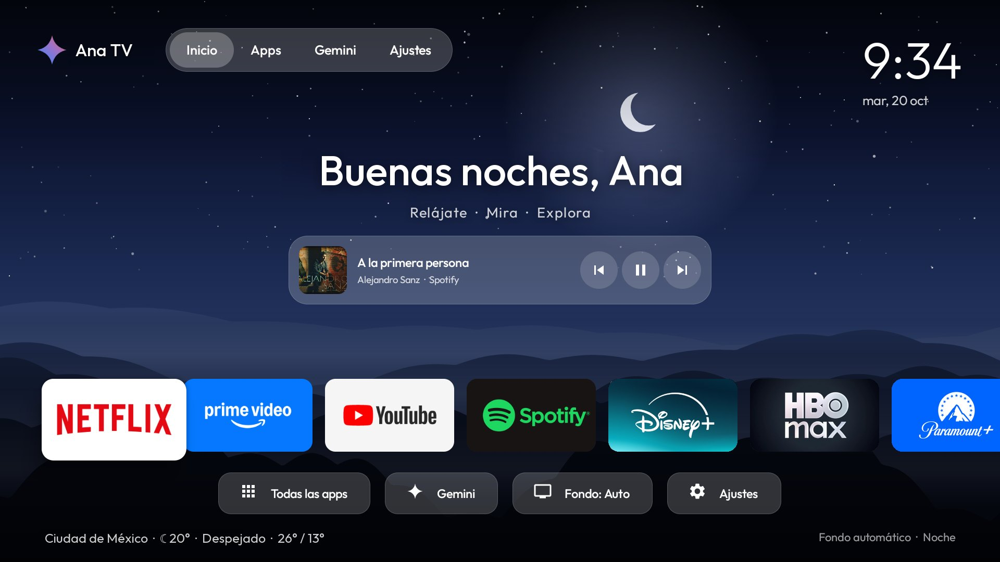 | 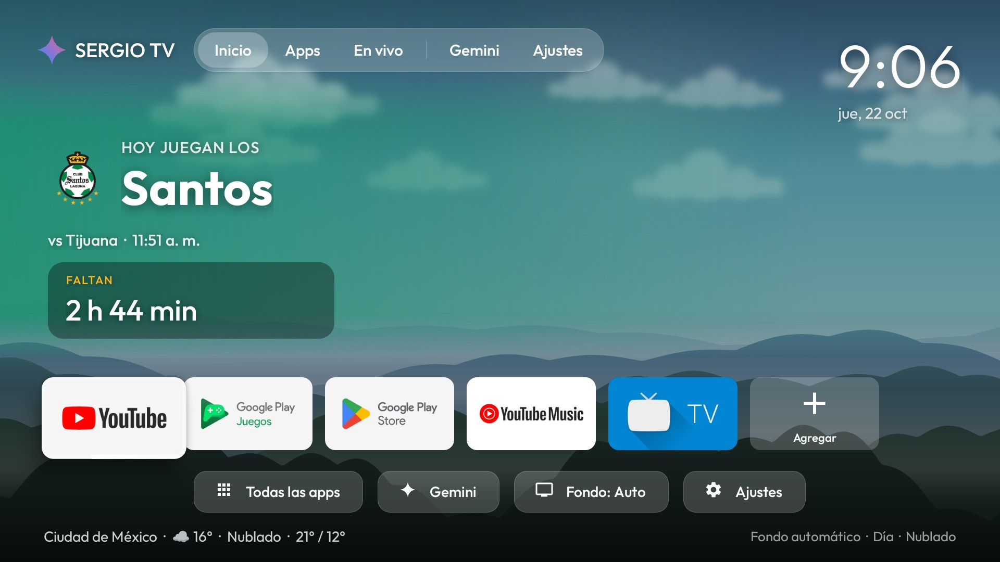 |

| Live game, at night | When your team wins |
|---|---|
| 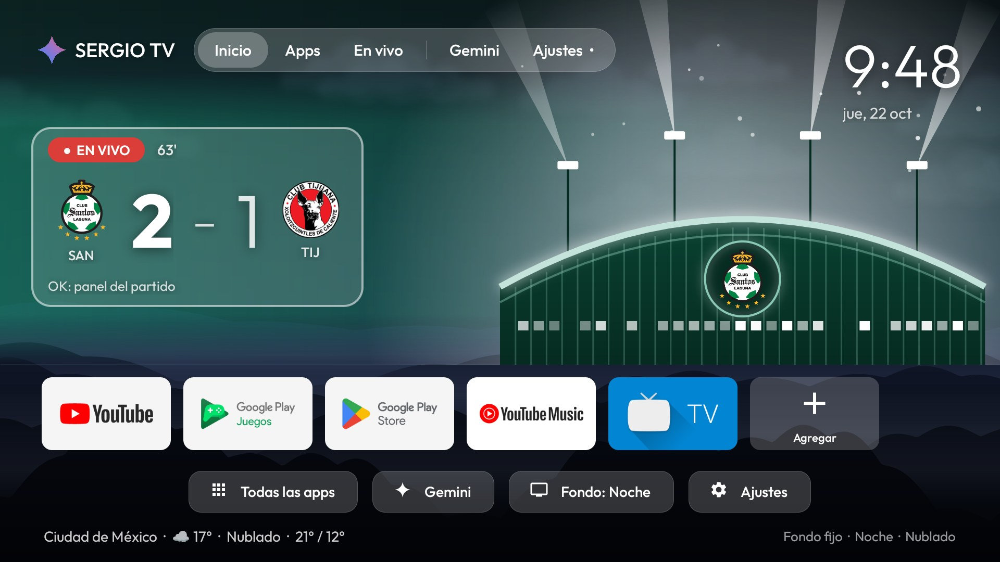 | 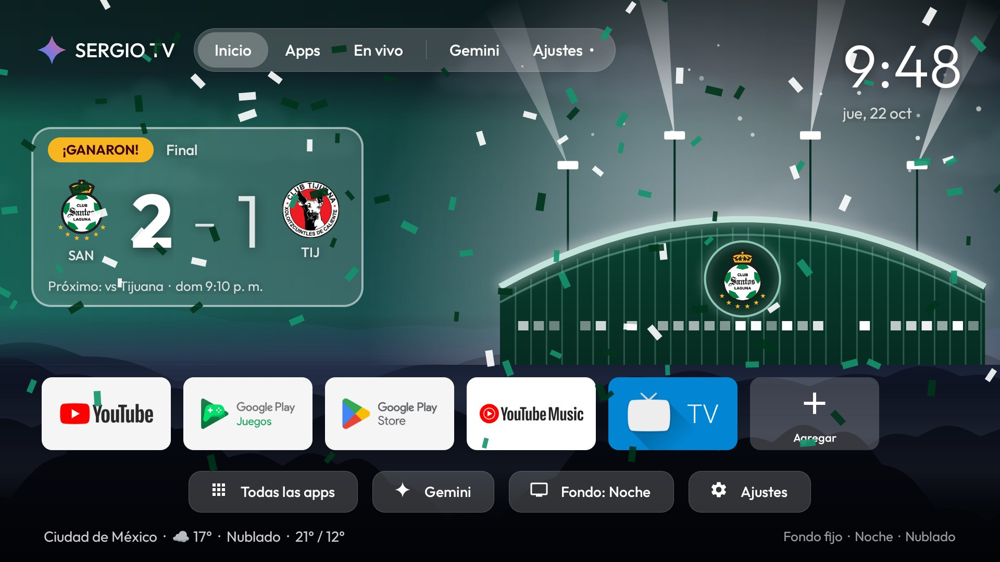 |

| Game panel, live | En vivo (Pluto TV and ViX) |
|---|---|
| 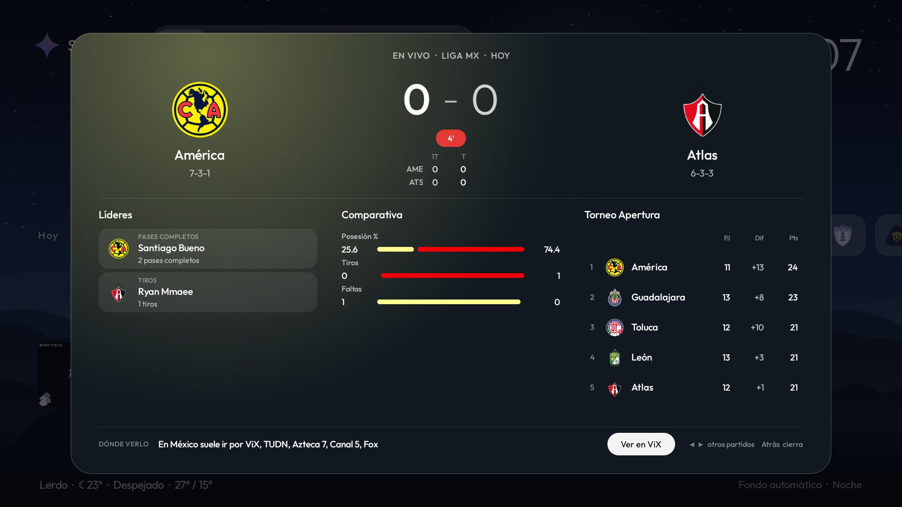 | 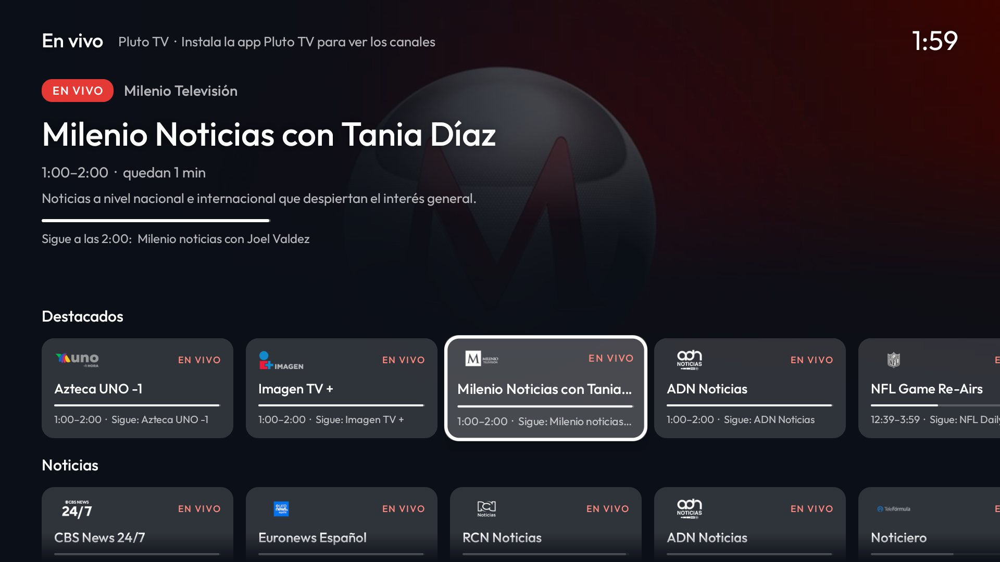 |

| Quick menu | All apps |
|---|---|
| 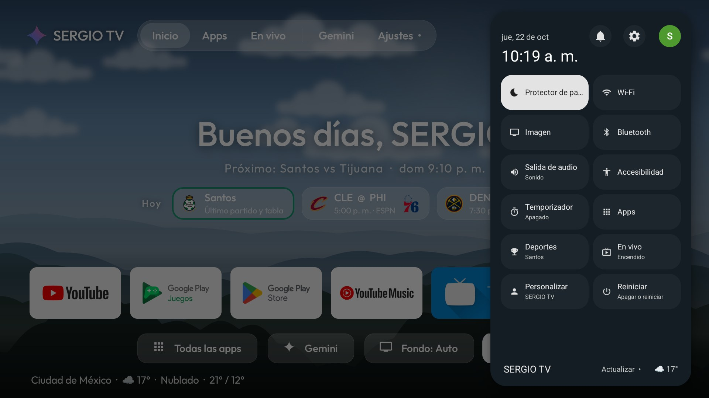 | 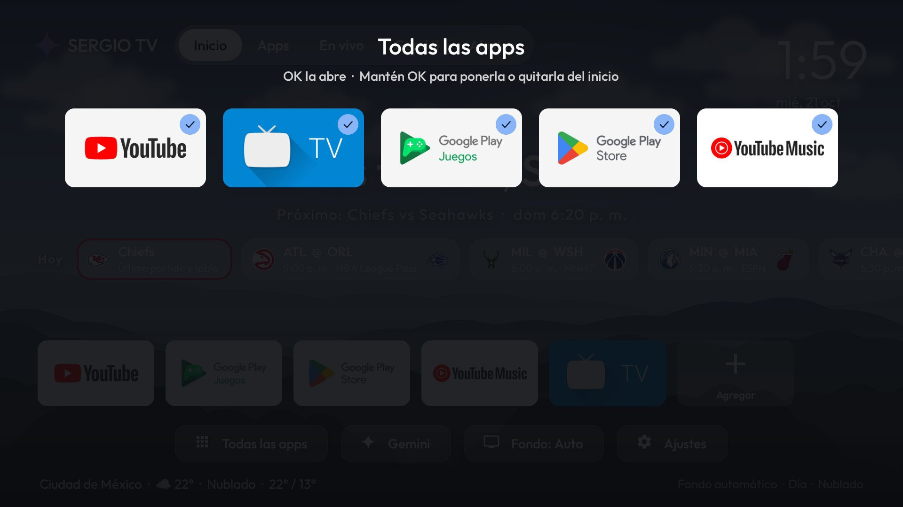 |

| Alert over another app | Holding OK on a channel |
|---|---|
| 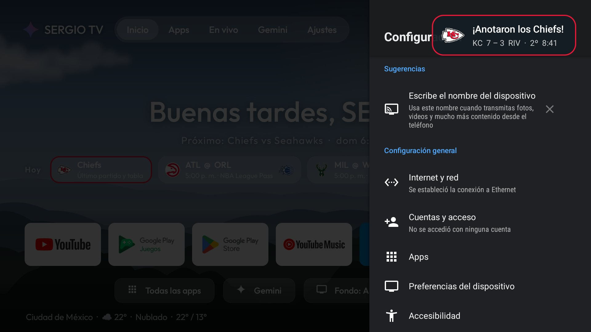 | 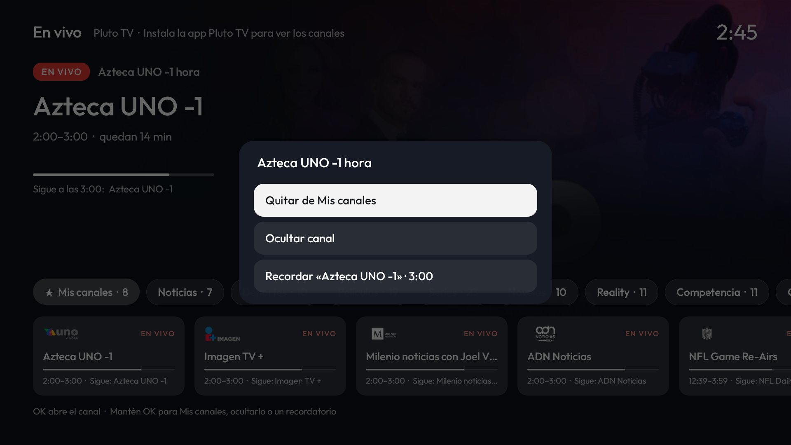 |

| About and updates | Screensaver |
|---|---|
| 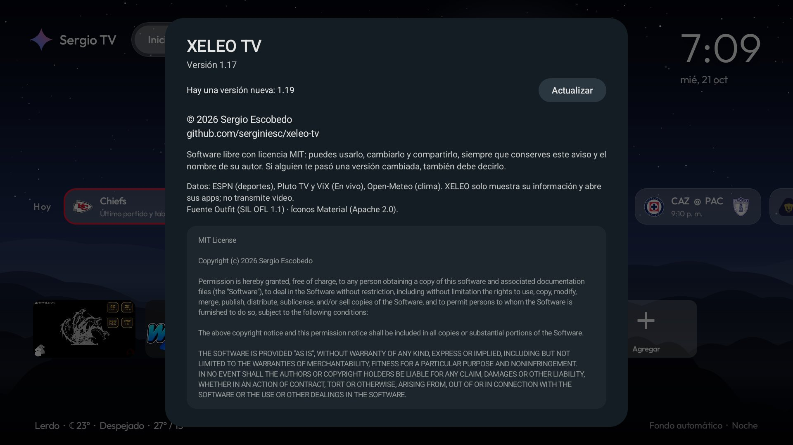 | 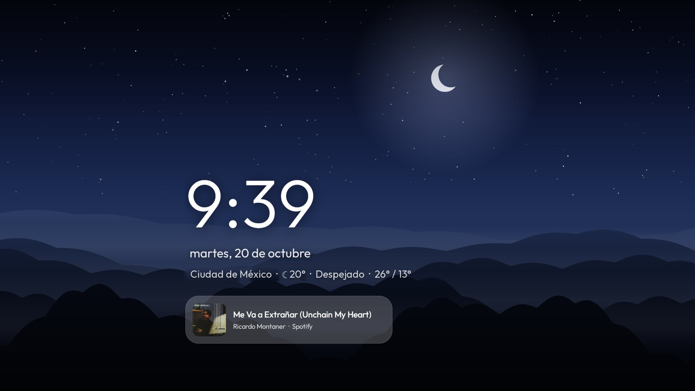 |

## What's in it

### Home

- **A fixed top bar** on every section: **Inicio (Home), Apps and En vivo (Live)** are tabs that switch as soon as
  the focus lands on them (▼ goes in, ▲ goes back to the tab you are on); **Gemini and Ajustes (Settings)** open
  with OK.
- **A landscape that follows the time of day:** dawn, day, sunset and night, worked out from your city's sunrise
  and sunset. Rain, snow, storms and fog show in the landscape (with animated rain and lightning).
- **A living sky:** at night the stars twinkle and drift slowly, with the odd shooting star or comet; by day,
  clouds and flocks of birds go by. It pauses as soon as you open an app.
- **Weather** for your city on the bottom line (Open-Meteo, no key).
- **A greeting and the TV's name** ("Buenas tardes, Sergio" · "Sergio TV"), editable on the TV.
- **A ring of light** on the selected app: a stripe that runs around it (in your team's colors on game day).
  While you move along the row the frame stays still; the light starts when you stop.
- **Only the apps you choose:** the first 6 show at first; the rest stay in All apps.
  - On Home, hold OK on an app to move it with ◀ ▶, or take it off with ▼.
  - In All apps, hold OK to put it on Home or take it off (the ones on Home have a ✓).
  - The **Agregar (Add)** button, at the end of the row, goes to All apps.
- **Recents:** the last apps you opened, whether from Home, the remote or Gemini.
- **Player:** what's playing on Spotify, YouTube, etc., with previous / pause / next, on Home and in the quick
  menu.

### Quick menu and screensaver

- **Quick menu** in the style of Google TV's (the remote's settings button, or Ajustes on Home): screensaver,
  Wi‑Fi, picture, Bluetooth, sound, accessibility, **sleep timer** (15/30/60/90 min), apps, Deportes (Sports),
  En vivo, Personalizar (Customize) and **Reiniciar (Restart)**.
- **Notifications** (the bell in the quick menu, with how many there are; Ajustes on Home gets a dot): without
  Google TV's launcher there is no other place to see them, and some things are only offered there, such as the
  remote's firmware update. OK opens one, holding OK dismisses it.
- **A matching screensaver:** landscape, a big clock that moves slowly, weather and the song playing.

### Sports mode (quick menu → Deportes, off by default)

- **A "Hoy" (Today) row** with the day's games of the leagues you pick (NFL, Liga MX, national teams, NBA, MLB),
  with live scores.
- **Your teams, one per league** (for example the Chiefs in the NFL and Santos in Liga MX). Home follows the one
  that plays soonest; on other days it says when your next game is. In the Hoy row, each of your teams that
  isn't playing gets a button with its last game and its standings.
- **Game day:** Home takes on your team's colors and, on the right, shows a recent photo from its ESPN news (it
  changes by itself, and skips sad stories); with none, an NFL team gets a poster of its starting QB in the
  team's colors with his number behind him, and other leagues a stadium drawn in the team's colors (lit up at
  night, with the crest on it). In the morning it's subtle; from 3 hours before, a big countdown; during the game,
  a big score (refreshed every 30 s); if your team wins, "¡Ganaron!" with confetti until the next morning. If it
  loses, Home goes back to normal. OK on the score opens the game panel. The photo can be turned off in
  Ajustes > Deportes.
- **Game panel:** OK on a game in "Hoy" opens the score by period, leaders, team stats, its group's standings
  and the next game. ◀ ▶ move to the other games; while a game is on it refreshes every 30 s.
- **Where to watch:** in the panel, the channels ESPN lists and where that league usually airs in Mexico (ViX,
  TUDN, Azteca 7, Canal 5, ESPN/Disney+, Fox…), with a button to open the app if you have it.
- **Alerts** over any app 15 minutes before kickoff, at the start, on each score and at the end. They can be
  turned off, in case you watch the game with a delay and don't want spoilers.
- Data from ESPN (a public service with no key, unofficial: it may change).

### En vivo (quick menu → En vivo, off by default)

- A tab with the **free channels of Pluto TV and ViX**, with a button per category and how many channels it has
  ("Noticias · 7", "Deportes en vivo · 11", "ViX · 10"…). Just landing on a button shows its channels.
- **Deportes en vivo (Live sports):** Pluto's sports channels (NFL Channel, Azteca Deportes, UFC…) together with
  ViX Deportes 24/7.
- **ViX:** its free channels (N+, N+ Foro, ViX Deportes, telenovelas…); OK opens the ViX app on that channel. ViX
  doesn't publish its schedule, so those have no listings.
- **Mis canales (My channels):** the first button. Out of the box it has Mexican broadcast TV, news and NFL
  Channel; hold OK on any channel to add or remove it (yours have a ★).
- **Hide channels** you don't care about, with the same held OK; they go to the "Ocultos" (Hidden) button in case
  you want them back.
- **Reminders:** in that same menu, "Recordar" (Remind me) the channel's next show; 5 minutes before, an alert
  shows over whatever you are watching.
- At the top, a **preview** of the selected channel: picture, show, description and time left.
- OK opens the channel in the **Pluto TV** or **ViX** app (install them from the Play Store; if they're missing,
  XELEO takes you there). XELEO only shows the guide; Pluto plays the video. The guide is preloaded from Home, so
  the tab opens instantly.
- Pluto TV guide (public, no key, unofficial: it may change). The ads when you open a channel are Pluto's or
  ViX's; XELEO doesn't control them.

### Updates

- XELEO **updates itself from GitHub**: every 6 hours it checks the version on Releases; if there is a new one,
  **Ajustes** shows a dot and quick menu → **Acerca de (About)** shows **Actualizar (Update)**. It downloads the
  APK and Android asks for a single OK on screen (an app can't update itself without asking). The first time,
  Android may ask you to allow "Install unknown apps" for XELEO TV; `install.sh` already allows it.

### Offline and reinstalling

- **Without internet** (for example, right after turning the TV on, with Wi‑Fi still connecting), Home shows the
  day's games, the weather and the En vivo guide it had saved, and refreshes them as soon as there is a network.
- **Settings backup:** your name, city, Home apps, Sports, My channels and reminders are saved to a file.
  `install.sh` copies it to the computer before installing and puts it back if the install had to start from
  scratch; it is also part of the TV's Google backup.

## Install

What you can do **without a computer**: install the APK (with the Downloader app or a USB stick), turn on its
services in the TV's settings (Accessibility → XELEO TV, Special app access → Notification access, System →
Screensaver) and update it from Acerca de. What **needs a computer, once**: making XELEO the screen the Home
button opens. Google TV has no setting to change the launcher, so that takes adb.

First, on the TV: Settings → System → About → press *Android TV OS build* 7 times; then Developer options → turn
on **USB debugging**. Find the TV's IP in Settings → Network & Internet → your network.

### With a ready-made APK

Download `XELEO-TV.apk` from [Releases](https://github.com/serginiesc/xeleo-tv/releases/latest) (GitHub builds it
on every change) or use the one you were given. Then, with
[adb](https://developer.android.com/tools/releases/platform-tools) (replace the IP with your TV's; the TV asks
"Allow USB debugging?": accept). It's installed with `pm install` because on Android 14 `adb install` keeps
waiting for an on-screen confirmation; in Git Bash on Windows, run `export MSYS_NO_PATHCONV=1` first.

```bash
adb connect 192.168.1.50:5555
adb push XELEO-TV.apk /data/local/tmp/xeleo.apk
adb shell pm install -r /data/local/tmp/xeleo.apk
adb shell cmd package set-home-activity --user 0 com.xeleo.tv/.HomeActivity
adb shell settings put secure enabled_accessibility_services com.xeleo.tv/.XeleoService
adb shell settings put secure accessibility_enabled 1
adb shell cmd notification allow_listener com.xeleo.tv/com.xeleo.tv.MediaListener
adb shell settings put secure screensaver_components com.xeleo.tv/com.xeleo.tv.SceneryDream
adb shell pm grant com.xeleo.tv android.permission.ACCESS_FINE_LOCATION
```

### Building it yourself

On the computer (Git Bash on Windows), with JDK 17 and the Android SDK:

```bash
./install.sh 192.168.1.50
```

The script builds, installs and sets XELEO TV as the home screen, screensaver and remote service. Before
installing it saves your settings to `respaldo-tv-<tv>.json` and, if it had to install from scratch (for example,
if the previous version was signed with another key), puts them back by itself. It also works with the emulator:
`./install.sh emulator-5554`.

Builds are signed with the XELEO TV key if `keystore.properties` exists (it isn't in the repo); otherwise, with
your computer's debug key.

### Either way

On Google TV you should also turn off Google's home screen, or it keeps the Home button:

```bash
adb shell pm disable-user --user 0 com.google.android.apps.tv.launcherx
adb shell pm disable-user --user 0 com.google.android.tungsten.setupwraith
```

(`pm enable` with the same names brings them back.) Before turning off `setupwraith`, check that your Wi‑Fi
network isn't one of its own (`adb shell dumpsys wifi | grep -o 'cname=[^ ]*'`): if it is, forget the network
and connect again.

When you're done, turn USB debugging off again. Then, in the quick menu: **Personalizar** (name and weather
city), **Deportes** (leagues and your teams) and **En vivo**, if you want them.

## Changing things

- **Name, greeting and weather city:** on the TV, quick menu → Personalizar. Out of the box there is no name
  ("Mi TV") and the weather is for Mexico City.
- **Default Home apps:** `dock_apps` in `app/src/main/res/values/config.xml` (they go first the first time).
- **Try other weather in the landscape** (to see how it looks):
  `adb shell am broadcast -n com.xeleo.tv/.ControlReceiver -a com.xeleo.tv.WEATHER_PREVIEW --ei code 61`
  (61 rain, 95 storm, 45 fog, 71 snow, 2 clouds, -1 the real weather).
- **See a sample game alert:**
  `adb shell am broadcast -n com.xeleo.tv/.ControlReceiver -a com.xeleo.tv.SPORTS_TEST`
- **See game day with your team** (`morning`, `soon`, `live`, `won`; `off` goes back to the real one;
  `--ez photo false` colors only, `--ez poster true` the poster or stadium instead of the photo,
  `--es league ligamx` your team in that league):
  `adb shell am broadcast -n com.xeleo.tv/.ControlReceiver -a com.xeleo.tv.GAMEDAY_PREVIEW --es moment live`
- **See a sample reminder** (it shows in a few seconds):
  `adb shell am broadcast -n com.xeleo.tv/.ControlReceiver -a com.xeleo.tv.REMINDER_TEST`
- **Back up or restore the settings by hand:** `-a com.xeleo.tv.BACKUP` writes
  `/sdcard/Android/data/com.xeleo.tv/files/xeleo-respaldo.json`; `-a com.xeleo.tv.RESTORE` reads them back.

## Automatic APK (for whoever maintains the repo)

`.github/workflows/apk.yml` builds the APK on every change to `main` and publishes it as the "ultima" release,
signed with the XELEO TV key. The key lives in the repo secrets: `XELEO_KEYSTORE_B64` (the `.jks` in base64),
`XELEO_KEYSTORE_PASSWORD`, `XELEO_KEY_ALIAS` and `XELEO_KEY_PASSWORD`. Without them, the build says so and
stops. The version number is the commit count (1.12, 1.13…).

## Notes

- Plain Java, no libraries. `minSdk 26`, `targetSdk 34`. The APK is about 170 KB.
- The app needs notification access (to know what's playing and to show the notifications panel) and an
  accessibility service (the remote's settings button, sleep timer, restart, recents and game alerts);
  `install.sh` turns them on.
- Font: [Outfit](https://github.com/Outfitio/Outfit-Fonts), SIL OFL 1.1 license (`docs/licencias/OFL-Outfit.txt`).
  Icons: Google's Material Icons (Apache 2.0). Team and channel logos, and game-day photos: from ESPN and Pluto
  TV, downloaded when used and not included in the repo.

## License

[MIT](LICENSE) © 2026 Sergio Escobedo. The Outfit font keeps its own license (SIL OFL 1.1).

If you make your own version, the license asks you to keep this notice and the author's name; XELEO shows it in
quick menu → **Acerca de**, so just don't remove it.
